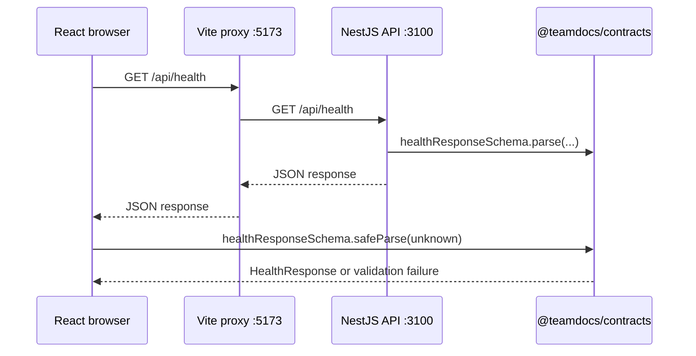

# TeamDocs

Учебный full-stack монорепозиторий для будущего приложения TeamDocs: работы с документами, API, а затем AI-функций. Сейчас это **рабочий фундамент**, а не готовый продукт: React-клиент получает health-ответ NestJS API через Vite proxy и проверяет входящий JSON общей runtime-схемой.

Проект находится в:

```text
/Applications/MAMP/htdocs/teamdocs
```

Подробная памятка по runtime-валидации: [`docs/ZOD_GUIDE.md`](docs/ZOD_GUIDE.md).

> Цель текущего этапа — не «сразу написать всё приложение», а создать корректные границы: browser ↔ API ↔ общий контракт. На этом фундаменте дальше будут появляться база данных, авторизация, документы, поиск и AI-модуль.

---

## Содержание

- [Быстрый старт](#быстрый-старт)
- [Что уже работает](#что-уже-работает)
- [Выбранный стек и почему](#выбранный-стек-и-почему)
- [Структура монорепозитория](#структура-монорепозитория)
- [npm workspaces](#npm-workspaces)
- [ESM в NestJS](#esm-в-nestjs)
- [TypeScript-конфигурация](#typescript-конфигурация)
- [Пакет `@teamdocs/contracts`](#пакет-teamdocscontracts)
- [Как проходит запрос health](#как-проходит-запрос-health)
- [Команды проекта](#команды-проекта)
- [Docker Compose](#docker-compose)
- [Oxlint и Prettier](#oxlint-и-prettier)
- [Проверка качества](#проверка-качества)
- [Переменные окружения и порты](#переменные-окружения-и-порты)
- [Что пока отсутствует](#что-пока-отсутствует)
- [Типичные ошибки и диагностика](#типичные-ошибки-и-диагностика)
- [Правила дальнейшей разработки](#правила-дальнейшей-разработки)
- [Следующие шаги](#следующие-шаги)

---

## Быстрый старт

### Требования

- Node.js с npm. Проект был реально собран в среде с `Node v26.7.0` и `npm 11.19.0`.
- macOS/Linux shell или любой терминал, где доступны `node` и `npm`.

Проверь версии:

```bash
node --version
npm --version
```

### Установка зависимостей

```bash
cd /Applications/MAMP/htdocs/teamdocs
npm install
```

`npm install` читает root `package.json`, находит все workspace-пакеты и создаёт единый `package-lock.json`.

### Запуск в режиме разработки

Открой **два терминала**.

Терминал 1 — API:

```bash
cd /Applications/MAMP/htdocs/teamdocs
npm run dev:api
```

Терминал 2 — frontend:

```bash
cd /Applications/MAMP/htdocs/teamdocs
npm run dev:web
```

После запуска:

- React/Vite: `http://localhost:5173`
- NestJS API: `http://localhost:3100`
- Health endpoint: `http://localhost:3100/api/health`

Проверить API без браузера:

```bash
curl http://localhost:3100/api/health
```

Ожидаемый формат:

```json
{
  "status": "ok",
  "service": "teamdocs-api",
  "timestamp": "2026-01-01T00:00:00.000Z"
}
```

В браузере открой `http://localhost:5173`. Карточка **API health** должна показать `ok`.

---

## Что уже работает

Это первая вертикальная функциональность проекта:

1. NestJS принимает `GET /api/health`.
2. API формирует ответ в соответствии с Zod schema из `@teamdocs/contracts`.
3. Vite development server проксирует запрос `/api/health` на NestJS API.
4. React выполняет `fetch('/api/health')`.
5. `response.json()` рассматривается как `unknown`, а не как уже доверенный TypeScript-тип.
6. React проверяет JSON через `healthResponseSchema.safeParse(...)`.
7. Только успешный runtime-parse превращает данные в `HealthResponse`.
8. UI отображает одно из состояний: `loading`, `ready` или `error`.

Это намеренно небольшой пример, но он демонстрирует важное production-правило:

> TypeScript проверяет исходный код до запуска, но не валидирует JSON, HTTP, env, БД или пользовательский ввод во время работы приложения.

---

## Выбранный стек и почему

| Технология | Где используется | Почему выбрана |
|---|---|---|
| **npm workspaces** | Весь репозиторий | Встроен в Node.js, прост для обучения, поддерживает монорепозиторий без отдельного package manager. |
| **TypeScript** | Во всех пакетах | Даёт строгие контракты, безопасный рефакторинг и общий язык типов между frontend и backend. |
| **React 19** | `apps/web` | Компонентный UI, привычная frontend-база для дальнейшей разработки TeamDocs. |
| **Vite** | `apps/web` | Быстрый dev server и production build для React. |
| **NestJS** | `apps/api` | Структурированный Node.js framework с модулями, DI, контроллерами, валидацией и удобной базой для backend. |
| **Node.js ESM** | `apps/api`, `packages/contracts` | Современная модульная модель, совместимая с текущим NestJS scaffold и package exports. |
| **Zod** | `packages/contracts` | Runtime-схемы, из которых выводятся TypeScript-типы. Один источник правды для формы данных. |
| **Vitest** | `apps/api` | Быстрый test runner для unit- и integration-тестов backend-кода. |
| **Oxlint** | web и API | Быстрый статический линтер для базовых ошибок и проблем качества. |
| **Prettier** | API dependency | Форматирование кода. Пока правила можно применять вручную; автоматический format script можно добавить позже. |

### Почему npm, а не pnpm или Bun

`pnpm` — хороший инструмент для больших монорепозиториев: он экономит место на диске и строже изолирует зависимости. Но он не обязателен. Здесь выбран npm, потому что:

- npm уже устанавливается вместе с Node.js;
- меньше новых инструментов одновременно с изучением TypeScript, React, NestJS и монорепозитория;
- npm workspaces полностью покрывают текущие задачи;
- один `package-lock.json` делает установку воспроизводимой.

Bun может быть быстрым, но сейчас он не приносит архитектурной пользы. Сначала важнее уверенно понимать стандартную Node/npm-среду. Позже Bun можно оценить отдельно, не смешивая его с базовой настройкой проекта.

---

## Структура монорепозитория

```text
teamdocs/
├── apps/
│   ├── web/                         # React + Vite browser application
│   │   ├── src/
│   │   │   ├── App.tsx              # UI и безопасный запрос health endpoint
│   │   │   ├── App.css
│   │   │   ├── main.tsx             # React entry point
│   │   │   └── index.css
│   │   ├── vite.config.ts            # Vite + proxy /api -> API
│   │   ├── tsconfig.json             # references на app/node конфиги
│   │   ├── tsconfig.app.json         # browser TypeScript
│   │   ├── tsconfig.node.json        # TypeScript для vite.config.ts
│   │   └── package.json
│   └── api/                          # NestJS API
│       ├── src/
│       │   ├── main.ts               # создаёт Nest app на порту 3100
│       │   ├── app.module.ts
│       │   ├── app.controller.ts     # GET /api/health
│       │   └── app.service.ts        # создаёт валидный HealthResponse
│       ├── tsconfig.json             # Node ESM TypeScript
│       ├── tsconfig.build.json
│       └── package.json
├── packages/
│   └── contracts/                    # общий исполняемый контракт
│       ├── src/index.ts              # Zod schemas и inferred types
│       ├── tsconfig.json
│       └── package.json
├── package.json                      # root workspace scripts
├── package-lock.json
├── tsconfig.base.json                # общая strict-политика
├── tsconfig.json                     # project references
└── README.md
```

### Почему `apps` и `packages` разделены

- `apps/*` — самостоятельные запускаемые приложения.
- `packages/*` — переиспользуемые библиотеки, которые сами по себе не являются продуктом для пользователя.

В будущем в `packages` могут появиться, например:

- `packages/contracts` — API schemas и DTO;
- `packages/config` — общие настройки ESLint/TypeScript только при реальной потребности;
- `packages/ui` — общие UI-компоненты, если они действительно понадобятся нескольким приложениям.

Не создавай общие пакеты «на всякий случай». Общая библиотека нужна, когда есть реальное повторное использование и ясная граница ответственности.

---

## npm workspaces

Root `package.json` объявляет пакеты:

```json
{
  "workspaces": ["apps/*", "packages/*"]
}
```

Это означает, что npm знает о трёх локальных пакетах:

```text
@teamdocs/web
@teamdocs/api
@teamdocs/contracts
```

### Root scripts

```json
{
  "scripts": {
    "dev:web": "npm run build --workspace=@teamdocs/contracts && npm run dev --workspace=@teamdocs/web",
    "dev:api": "npm run build --workspace=@teamdocs/contracts && npm run start:dev --workspace=@teamdocs/api",
    "typecheck": "npm run build --workspace=@teamdocs/contracts && npm run typecheck --workspace=@teamdocs/web && npm run typecheck --workspace=@teamdocs/api",
    "build": "npm run build --workspace=@teamdocs/contracts && npm run build --workspace=@teamdocs/web && npm run build --workspace=@teamdocs/api",
    "lint": "npm run lint --workspace=@teamdocs/web && npm run lint --workspace=@teamdocs/api"
  }
}
```

### Почему contracts собираются первыми

`@teamdocs/contracts` публикует только содержимое `dist`:

```json
{
  "exports": {
    ".": {
      "types": "./dist/index.d.ts",
      "import": "./dist/index.js"
    }
  }
}
```

Значит, API и frontend импортируют package так же, как в реальном package boundary:

```ts
import { healthResponseSchema } from '@teamdocs/contracts';
```

Они **не** импортируют исходники обходным путём:

```ts
// Плохо: так нельзя
import { healthResponseSchema } from '../../../packages/contracts/src/index.ts';
```

Сборка contracts до запуска остальных workspace-пакетов гарантирует существование `dist/index.js` и `dist/index.d.ts`.

---

## ESM в NestJS

### Что такое ESM

ESM (ECMAScript Modules) — современная стандартная модульная система JavaScript. Она использует `import` и `export` как нативный формат Node.js.

В API включено:

```json
{
  "type": "module"
}
```

и в `tsconfig.json`:

```json
{
  "compilerOptions": {
    "module": "NodeNext",
    "moduleResolution": "NodeNext"
  }
}
```

### Почему выбран ESM, а не CommonJS

Для нового TeamDocs выбран ESM, потому что текущий NestJS CLI создаёт новый проект именно в этом стиле. Он уже использует:

```ts
import { AppModule } from './app.module.js';
```

В исходнике существует `app.module.ts`, но `.js` в import нужен для корректного Node ESM runtime **после компиляции**, когда на диске будет `app.module.js`.

Не меняй случайно `.js` на `.ts` и не убирай расширение во внутренних Node ESM imports. Иначе production-сборка может не запуститься в Node.

### Когда стоило бы выбрать CommonJS

CommonJS уместен, если проект уже использует CommonJS-зависимости, старую инфраструктуру или legacy tooling. Но не стоит менять новый ESM проект только потому, что CommonJS кажется привычнее. Два режима требуют разных правил imports и конфигурации. Здесь проще и надёжнее придерживаться одного режима — ESM.

---

## TypeScript-конфигурация

### Общий `tsconfig.base.json`

```json
{
  "compilerOptions": {
    "strict": true,
    "noUncheckedIndexedAccess": true,
    "exactOptionalPropertyTypes": true,
    "noImplicitOverride": true,
    "useUnknownInCatchVariables": true,
    "forceConsistentCasingInFileNames": true,
    "skipLibCheck": true
  }
}
```

Этот конфиг содержит только **общую политику качества**. В нём специально нет `DOM`, Node types, `module` и `moduleResolution`, потому что browser и Node — разные среды.

#### Что дают важные флаги

| Опция | Что предотвращает |
|---|---|
| `strict` | Неявный `any`, работа с возможными `null`/`undefined` и другие небезопасные допущения. |
| `noUncheckedIndexedAccess` | Ошибочное предположение, что `items[0]` или `map[key]` обязательно существуют. |
| `exactOptionalPropertyTypes` | Смешивание «свойство отсутствует» и «свойство существует, но равно undefined». |
| `noImplicitOverride` | Случайное переопределение метода базового класса без `override`. |
| `useUnknownInCatchVariables` | Небезопасный доступ к `error.message`, когда в `catch` могло быть выброшено любое значение. |
| `forceConsistentCasingInFileNames` | Импорты с неправильным регистром, которые могут работать на macOS, но сломаться в Linux CI. |
| `skipLibCheck` | Ускоряет проверку деклараций сторонних библиотек, не отключая проверку нашего кода. |

### Root `tsconfig.json`

```json
{
  "files": [],
  "references": [
    { "path": "./packages/contracts" },
    { "path": "./apps/web/tsconfig.app.json" },
    { "path": "./apps/web/tsconfig.node.json" },
    { "path": "./apps/api" }
  ]
}
```

Это solution config: в нём нет исходников. Он описывает TypeScript-проекты и их границы.

### Frontend: `apps/web/tsconfig.app.json`

Frontend — браузерное приложение. Поэтому ему нужны DOM-типы:

```json
{
  "lib": ["ES2023", "DOM", "DOM.Iterable"],
  "module": "ESNext",
  "moduleResolution": "bundler",
  "jsx": "react-jsx",
  "types": ["vite/client"],
  "noEmit": true
}
```

- `DOM` даёт типы `document`, `fetch`, `HTMLInputElement`, `AbortController` и остальных browser APIs.
- `DOM.Iterable` нужен для iterable browser collections.
- `moduleResolution: "bundler"` соответствует механике Vite.
- `jsx: "react-jsx"` включает современную JSX-трансформацию.
- `noEmit: true` означает: TypeScript проверяет код, а Vite отвечает за превращение frontend-кода в bundle.

### Vite config: `apps/web/tsconfig.node.json`

`vite.config.ts` выполняется Node.js, хотя сам React-код работает в браузере. Поэтому это отдельный TS-project:

```json
{
  "lib": ["ES2023"],
  "module": "NodeNext",
  "moduleResolution": "NodeNext",
  "types": ["node"],
  "noEmit": true
}
```

Так `vite.config.ts` может использовать Node API, а компоненты React не начинают случайно видеть `process`, `Buffer` и другие server globals.

### API: `apps/api/tsconfig.json`

API — Node ESM приложение:

```json
{
  "module": "NodeNext",
  "moduleResolution": "NodeNext",
  "lib": ["ES2023"],
  "types": ["node"],
  "rootDir": "./src",
  "outDir": "./dist",
  "experimentalDecorators": true,
  "emitDecoratorMetadata": true
}
```

- В API **нет** `DOM`, поэтому `document` не должен быть доступен.
- `types: ["node"]` добавляет Node globals, `Buffer`, `process` и типы built-in модулей.
- `rootDir` и `outDir` определяют, откуда NestJS собирает `.ts` и куда пишет runtime `.js`.
- Decorator options нужны NestJS для `@Module`, `@Controller`, `@Injectable` и dependency injection metadata.

---

## Пакет `@teamdocs/contracts`

### Зачем он нужен

Frontend и backend должны одинаково понимать форму API-данных. Наивный подход — скопировать тип дважды:

```ts
// web
interface HealthResponse { /* ... */ }

// api
interface HealthResponse { /* ... */ }
```

Так типы постепенно расходятся. Общий package предотвращает расхождение, но важнее другое: в нём находится **runtime schema**, а не только type alias.

### Текущие контракты

`packages/contracts/src/index.ts` экспортирует:

- `healthResponseSchema` и `HealthResponse`;
- `documentStatusSchema` и `DocumentStatus`;
- `documentSummarySchema` и `DocumentSummary`.

Пример:

```ts
export const healthResponseSchema = z.object({
  status: z.literal('ok'),
  service: z.literal('teamdocs-api'),
  timestamp: z.iso.datetime(),
});

export type HealthResponse = z.infer<typeof healthResponseSchema>;
```

`z.infer` выводит статический TypeScript-тип из того же определения, которое проверяет реальные данные в runtime.

### Что должно и не должно попадать в contracts

Подходит:

- API request/response DTO;
- литеральные статусы;
- Zod schemas;
- идентификаторы, pagination models;
- форматы ошибок API.

Не подходит:

- React state и props;
- React hooks;
- NestJS services, controllers, modules;
- ORM entities и database connections;
- auth secrets;
- server environment variables;
- UI-specific formatters.

Contracts — это публичное соглашение между слоями, а не свалка всего общего кода.

---

## Как проходит запрос health



### Backend

`AppService` создаёт ответ и проверяет его перед возвратом:

```ts
getHealth(): HealthResponse {
  return healthResponseSchema.parse({
    status: 'ok',
    service: 'teamdocs-api',
    timestamp: new Date().toISOString(),
  });
}
```

### Frontend

React получает данные как `unknown`:

```ts
const response = await fetch('/api/health', { signal });
const body: unknown = await response.json();
const parsed = healthResponseSchema.safeParse(body);
```

Дальше проверяются отдельно:

1. HTTP-статус — `response.ok`;
2. форма данных — `parsed.success`.

Нельзя заменять это небезопасным приведением:

```ts
// Плохо: проверка существует только в воображении TypeScript
const body = (await response.json()) as HealthResponse;
```

### UI states

```ts
type HealthState =
  | { kind: 'loading' }
  | { kind: 'ready'; value: HealthResponse }
  | { kind: 'error'; message: string };
```

Discriminated union заставляет UI обработать все состояния запроса. `AbortController` отменяет in-flight request, если React-компонент размонтируется.

---

## Команды проекта

Все команды запускаются из root проекта:

```bash
cd /Applications/MAMP/htdocs/teamdocs
```

| Команда | Действие |
|---|---|
| `npm install` | Устанавливает зависимости всех workspaces. |
| `npm run dev:api` | Собирает contracts и запускает NestJS watch mode на порту `3100`. |
| `npm run dev:web` | Собирает contracts и запускает Vite на порту `5173`. |
| `npm run typecheck` | Собирает contracts, затем проверяет web и API TypeScript. |
| `npm run build` | Production build contracts → web → API. |
| `npm run lint` | Запускает Oxlint в web и API. |
| `npm run test` | Собирает contracts и запускает Vitest tests для API. |
| `npm run docker:up` | Собирает и запускает web, API и PostgreSQL через Docker Compose. |
| `npm run docker:down` | Останавливает контейнеры, сохраняя данные PostgreSQL в named volume. |
| `npm run docker:logs` | Показывает live-логи контейнеров. |
| `npm ci` | Чистая воспроизводимая установка по `package-lock.json`; подходит для CI. |

### Команды конкретного workspace

```bash
npm run build --workspace=@teamdocs/contracts
npm run typecheck --workspace=@teamdocs/web
npm run start:dev --workspace=@teamdocs/api
```

Используй workspace-команды, когда нужно локализовать ошибку в конкретном пакете.

---

## Docker Compose

Docker Compose даёт одинаковый локальный способ запуска всей инфраструктуры одной командой: React frontend, NestJS API и PostgreSQL.

### Первый запуск

```bash
cd /Applications/MAMP/htdocs/teamdocs
cp .env.example .env
# Измени POSTGRES_PASSWORD в .env на уникальный локальный пароль.
npm run docker:up
```

Если `.env` отсутствует, Compose использует учебный локальный пароль `teamdocs-local-only`, чтобы `docker compose up --build` всё равно запускался одной командой. Это допустимо только для локальной разработки; для любого shared/staging/production окружения задай уникальный пароль через `.env` или секреты платформы.

После готовности контейнеров:

| Сервис | Адрес |
|---|---|
| Web через Nginx | `http://localhost:5173` |
| API напрямую | `http://localhost:3100/api/health` |
| API через web reverse proxy | `http://localhost:5173/api/health` |

Остановка контейнеров без удаления PostgreSQL-данных:

```bash
npm run docker:down
```

Логи:

```bash
npm run docker:logs
```

### Что запускает `compose.yaml`

| Service | Роль | Особенности |
|---|---|---|
| `postgres` | Будущая реляционная БД TeamDocs | PostgreSQL 16, healthcheck и persistent named volume. |
| `api` | NestJS production build | Ждёт healthcheck PostgreSQL, получает внутренний `DATABASE_URL`, отдаёт API на порту 3100. |
| `web` | Собранный Vite frontend | Nginx отдаёт React static files и проксирует `/api/*` к контейнеру API. |

### Persistent PostgreSQL volume

В `compose.yaml` определён named volume:

```yaml
volumes:
  postgres_data:
    name: teamdocs_postgres_data
```

Контейнер PostgreSQL монтирует его в `/var/lib/postgresql/data`. Поэтому `npm run docker:down` останавливает и удаляет контейнеры, но **не удаляет данные БД**. Когда мы подключим Drizzle/ORM и migrations, схема и данные останутся между перезапусками.

Полностью удалить контейнеры **и данные локальной БД** можно только осознанно:

```bash
docker compose down --volumes
```

Эта команда необратимо удаляет local database volume. Не используй её, если данные нужны.

### Docker-файлы

- `Dockerfile.api` — multi-stage build: устанавливает npm workspaces, собирает contracts и NestJS, затем запускает только собранный API на Node 22 Alpine.
- `Dockerfile.web` — multi-stage build: собирает contracts и Vite bundle, затем Nginx отдаёт статические файлы.
- `docker/nginx/default.conf` — поддерживает React SPA fallback и проксирует `/api/` в `api:3100` внутри Docker network.
- `.dockerignore` — не отправляет в build context local `node_modules`, `dist`, `.env`, Git metadata и editor state.

### Development и Docker — разные режимы

`npm run dev:web` и `npm run dev:api` — быстрый режим разработки с HMR/watch mode.

`npm run docker:up` — production-подобный локальный запуск: Vite заранее собран, frontend раздаёт Nginx, API запускает compiled JavaScript. Контейнеры не предназначены для HMR. Это намеренное разделение: Docker проверяет способ доставки приложения, а Vite/Nest watch mode ускоряет разработку.

---

## Oxlint и Prettier

### Что такое Oxlint

Oxlint — быстрый линтер JavaScript/TypeScript-кода. Он анализирует исходники без запуска программы и помогает обнаружить проблемы раньше, чем они дойдут до браузера или production.

В проекте:

```bash
npm run lint
```

выполняет:

```bash
oxlint            # внутри apps/web
oxlint src/       # внутри apps/api
```

Oxlint не заменяет TypeScript:

- TypeScript отвечает за типы и корректность контрактов.
- Oxlint отвечает за набор статических правил качества.
- Build доказывает, что конкретный bundler/framework может собрать проект.
- Runtime endpoint проверяет, что приложение реально стартует и отвечает.

Все четыре уровня полезны и ловят разные классы ошибок.

### Что делает Prettier

Prettier форматирует код: отступы, кавычки, переносы строк, порядок пробелов. Он не проверяет бизнес-логику и не заменяет lint/typecheck.

Prettier уже находится в devDependencies API. Когда появится единый style guide, можно добавить root script, например:

```json
{
  "format": "prettier --write \"apps/**/*.{ts,tsx,json,css,md}\" \"packages/**/*.{ts,json}\""
}
```

Не добавляй script автоматически, пока правила форматирования не согласованы для всего репозитория.

---

## Проверка качества

Перед значимым изменением и перед commit запускай:

```bash
npm run lint
npm run test
npm run typecheck
npm run build
```

Что доказывают команды:

| Проверка | Что подтверждает |
|---|---|
| `lint` | Код соответствует правилам Oxlint. |
| `test` | Проверяет поведение API-кода через Vitest. |
| `typecheck` | TypesScript контракты, imports и конфиги согласованы. |
| `build` | Contracts собираются, Vite создаёт frontend bundle, NestJS создаёт API output. |
| `curl /api/health` | API действительно запущен и возвращает ожидаемый ответ. |
| Открытие Vite UI | Proxy, React и runtime validation работают совместно. |

### Тесты

В API подключён **Vitest**. Конфигурация находится в `apps/api/vitest.config.ts`, а базовый unit test — в `apps/api/src/app.service.spec.ts`.

Он проверяет, что `AppService` возвращает health payload, соответствующий shared Zod contract из `@teamdocs/contracts`. Это связывает тестирование с нашим главным правилом: API не должен расходиться с runtime schema.

Запуск тестов:

```bash
npm run test
```

Для watch mode при разработке API:

```bash
npm run test:watch --workspace=@teamdocs/api
```

Перед реализацией новой domain logic — документов, авторизации, прав доступа, DB queries или RAG — добавляй тест вместе с функцией, которую он защищает: unit tests для чистой логики и integration tests для API/БД границ.

---

## Переменные окружения и порты

### Текущие порты

| Сервис | Адрес | Назначение |
|---|---|---|
| Vite | `http://localhost:5173` | Frontend в development. |
| NestJS | `http://localhost:3100` | API в development. |
| Health endpoint | `http://localhost:3100/api/health` | Проверка работоспособности API. |

API использует порт по умолчанию `3100`:

```ts
await app.listen(Number(process.env.PORT ?? 3100), '0.0.0.0');
```

Его можно заменить перед запуском:

```bash
PORT=3200 npm run dev:api
```

Если изменишь API-порт, обнови Vite proxy в `apps/web/vite.config.ts`:

```ts
server: {
  proxy: {
    '/api': 'http://localhost:3100',
  },
},
```

### Env-файлы

Для Docker Compose есть `.env.example` с настройками локального PostgreSQL. Скопируй его в `.env`; сам `.env` игнорируется Git. Когда появятся auth keys или AI API keys:

1. не коммить секреты;
2. добавь `.env.example` без реальных значений;
3. проверяй env в runtime через отдельную schema;
4. не передавай server secrets во frontend;
5. frontend может видеть только переменные с осознанно публичным префиксом Vite (`VITE_`).

---

## Что пока отсутствует

Это важный список, чтобы не принять foundation за завершённый продукт.

Пока **нет**:

- ORM и использование PostgreSQL из application code; контейнер PostgreSQL, persistent volume и будущая точка подключения `DATABASE_URL` уже подготовлены;
- регистрации, login, сессий и refresh tokens;
- RBAC, organisations или multi-tenant isolation;
- CRUD документов;
- загрузки файлов;
- серверной валидации входящих DTO;
- pagination, filtering, search;
- CI workflow;
- observability, logs, metrics, error tracking;
- Redis/cache/rate limiting;
- AI provider, embeddings, vector search, RAG;
- production reverse proxy/CORS/security headers;
- полноценного test suite.

Все эти части будут добавляться последовательно в соответствующих разделах курса. Не обходи учебный порядок, вставляя базу данных или AI key прямо в `App.tsx`.

---

## Типичные ошибки и диагностика

### `Cannot find module '@teamdocs/contracts'`

Причина: contracts ещё не собраны, а package exports указывают на `dist`.

Решение:

```bash
npm run build --workspace=@teamdocs/contracts
npm run typecheck
```

Обычно root scripts делают это автоматически.

### API не запускается: `EADDRINUSE`

Это означает, что порт уже занят другим процессом.

Проверь порт:

```bash
lsof -nP -iTCP:3100 -sTCP:LISTEN
```

Либо освободи порт, либо запусти API с другим `PORT` и синхронно обнови Vite proxy.

### Frontend показывает ошибку API

Проверь по порядку:

```bash
curl http://localhost:3100/api/health
curl http://localhost:5173/api/health
```

- Первая команда проверяет NestJS напрямую.
- Вторая дополнительно проверяет Vite proxy.

Если первая работает, а вторая нет — проблема обычно в `apps/web/vite.config.ts` или Vite нужно перезапустить после изменения config.

### В backend не находится локальный import

В ESM NestJS относительные imports должны использовать `.js`:

```ts
import { AppService } from './app.service.js';
```

Не пиши `.ts` и не удаляй расширение.

### `document` или `window` используются в API

Это архитектурная ошибка: browser API не должны жить в NestJS. API config специально не включает DOM types.

### `process` используется в React-компоненте

Это другая архитектурная ошибка: browser bundle не должен напрямую получать Node globals. Используй `import.meta.env` только для явно публичных Vite variables и проверяй их отдельно.

### "Но TypeScript говорит, что response правильный"

TypeScript не видит настоящую сеть. Любой HTTP JSON — недоверенный вход. Используй schema parse (`safeParse`/`parse`) на границе.

---

## Правила дальнейшей разработки

1. **Не используй `any` как способ убрать ошибку.** Сначала выясни, откуда пришло значение и какой контракт оно должно иметь.
2. **Не используй `as SomeType` для HTTP JSON.** Валидируй данные Zod schema.
3. **Не дублируй API DTO в web и API.** Если контракт правда общий — добавь schema в `@teamdocs/contracts`.
4. **Не импортируй `contracts/src` относительным путём.** Импортируй package name.
5. **Не добавляй DOM types в base config или API config.** Это разрушит границу browser/server.
6. **Не добавляй Node types в browser app config.** `vite.config.ts` уже имеет отдельный Node config.
7. **Не меняй ESM на CommonJS одной опцией.** Это затрагивает package `type`, imports, Node runtime и build output.
8. **Не храните secrets в React.** Всё, что попало в Vite bundle, доступно пользователю браузера.
9. **Сначала запускай lint → typecheck → build.** Только потом считай изменение готовым.
10. **Делай вертикальные slices.** Новый endpoint должен иметь schema, API implementation, client validation и UI-state, а не только один слой.

---

## Следующие шаги

Рекомендуемый порядок развития TeamDocs:

1. Добавить первый доменный endpoint `GET /api/documents` с `DocumentSummary` из contracts.
2. Ввести runtime-валидацию входящих request DTO в NestJS.
3. Подключить PostgreSQL и migrations.
4. Добавить пользователей, organisations, authentication и RBAC.
5. Реализовать CRUD документов и audit trail.
6. Добавить тесты для domain logic и API integration boundaries.
7. Поднять Docker Compose для API и PostgreSQL.
8. Добавить Python/FastAPI AI service как отдельную границу.
9. Реализовать retrieval, citations, evaluation и безопасность RAG.

Каждый следующий шаг должен сохранять текущий принцип: **contract → runtime validation → implementation → UI state → quality checks**.

---

## Связь с курсом

Подробное теоретическое объяснение этой конфигурации находится в Notion в первой главе TypeScript Academy:

**«00 · Установка TypeScript и tsconfig для Vite + NestJS монорепозитория»**

README — практическая документация именно этого репозитория. Notion-глава объясняет, почему приняты эти решения и как применять подход в новых проектах.
